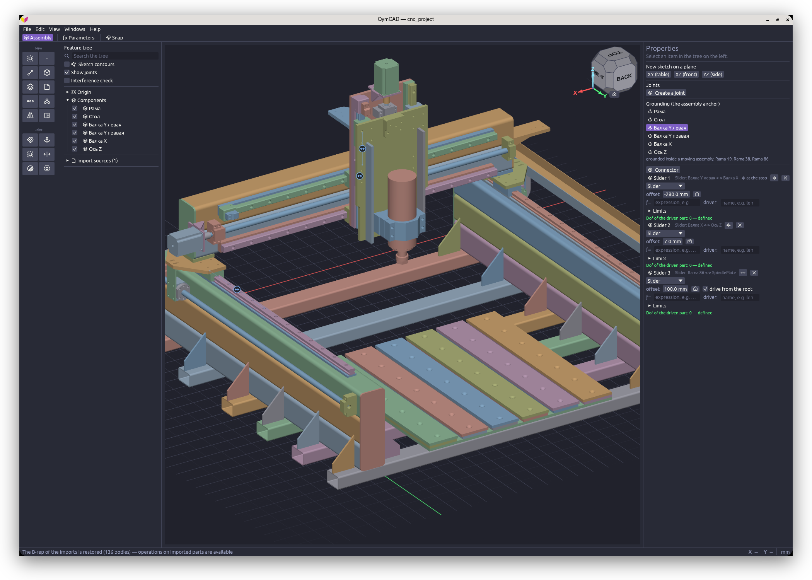

<div align="center">


# QymCAD

**Un CAD paramétrico y asociativo con núcleo B-rep**

Boceto → pieza → ensamblaje. Un solo programa, un único archivo de proyecto, sin nube ni suscripción.

[cad.qymis.tech](https://cad.qymis.tech)

[English](README.md) | **Español** | [Русский](README.ru.md) | [Українська](README.uk.md) | [Қазақша](README.kk.md)



</div>

## Qué es

QymCAD es un CAD de escritorio para piezas mecánicas y ensamblajes: carcasas, soportes, mecanismos, piezas
impresas y fresadas.

Un boceto se convierte en sólido mediante extrusión, revolución o barrido; al sólido se le pueden añadir
agujeros, redondeos, vaciado y patrones. Las piezas se integran en un ensamblaje mediante uniones: de
revolución, correderas, rígidas, etc. El modelo es paramétrico: modifique una cota en cualquier operación
y todo lo que dependa de ella en el historial se recalculará, incluyendo el ensamblaje.

La geometría es exacta y sólida (B-rep), calculada mediante el núcleo [OpenCASCADE](https://dev.opencascade.org/),
el mismo que utiliza FreeCAD. De ahí que proporcione superficies precisas en lugar de mallas poligonales,
redondeos correctos e intercambio mediante STEP con otros sistemas CAD.

La interfaz está disponible en español, inglés, kazajo, ucraniano y ruso.

## Estado del proyecto

Versión en desarrollo. El programa funciona y es apto para piezas reales, pero se actualiza a diario.

- **El formato de documento cambia sin compatibilidad hacia atrás.** Es posible que un archivo guardado
  con una versión anterior no se abra. Para dichos archivos existe el script `convert_qcad.py` (véase más adelante).
- **El módulo CNC (CAM) no funciona.** En la configuración existe la casilla «Pestaña Mecanizado (CAM)»,
  pero lo que hay detrás es trabajo preliminar: parte del código proviene de una versión anterior y no
  se mantiene activamente. El módulo volverá en la versión alfa estable.
- **La compilación para macOS no está firmada por Apple.** Está firmada e íntegra, pero con un certificado
  que no emitió Apple, por lo que en el primer inicio macOS indica que no puede verificar la aplicación y
  se niega a abrirla. Se permite una sola vez, con el botón «Abrir igualmente» en Ajustes del Sistema ->
  Privacidad y seguridad; los pasos están en las notas junto a la aplicación.

## Características

**Bocetos.** Líneas, arcos, circunferencias, elipses, splines, polígonos, colisas y texto. Las restricciones
y cotas se resuelven de forma conjunta; las cotas son paramétricas (`w/2`, `sin(a)`). Dispone de geometría auxiliar
y de proyección de aristas de cuerpos sobre el boceto.

**Piezas.** Extrusión, revolución, barrido, solevación, redondeo (incluido radio variable en vértices),
chaflán, vaciado, desmoldeo, agujeros (simples, con cajeado, con avellanado), engrosado, parche, cosido,
recorte, división de caras y de cuerpo, copia y empuje de caras, patrones lineales y circulares, simetría,
operaciones booleanas y primitivas: caja, cilindro, esfera, cono, toroide y prisma. Las roscas se generan
mediante un perfil helicoidal real con salidas de rosca.

**Ensamblajes.** Piezas y subensamblajes, uniones (rígida, revolución, corredera, cilíndrica, plana, esférica,
perno-colisa, paralela), límites y accionamientos, grados de libertad y comprobación de colisiones/interferencias.
Un boceto puede ubicarse sobre la cara de una pieza contigua como referencia asociativa: modifique la pieza
vecina y la pieza dependiente se regenerará automáticamente.

**Intercambio de datos.** STEP (importación y exportación), STL (importación y exportación), DXF y SVG (importación
y exportación de bocetos). Es posible exportar el proyecto completo o una única pieza o subensamblaje
seleccionado en el árbol.

## Instalación

Las versiones compiladas están disponibles en [Releases](../../releases). No se necesitan bibliotecas
adicionales: OpenCASCADE y las dependencias están incluidas dentro del paquete.

**Windows 10/11 x64** — `qymcad-win64.zip`. Descomprima en cualquier carpeta y ejecute `qymcad.exe`.

**Linux** — `qymcad-*.AppImage`, un único archivo ejecutable. Requiere glibc 2.35 o superior: Ubuntu 22.04+,
Debian 12+, Fedora 36+, Arch.

```bash
chmod +x qymcad-*.AppImage
./qymcad-*.AppImage
```

**macOS 12+** — para Apple Silicon (M1 y posteriores) `qymcad-*-macos-arm64.dmg`, para Intel
`qymcad-*-macos-x86_64.dmg`. Abra la imagen de disco y arrastre QymCAD a Aplicaciones. El primer inicio se rechaza
una vez, porque la compilación no está firmada por Apple: pulse «Abrir igualmente» en Ajustes del Sistema ->
Privacidad y seguridad. `LÉAME.txt` en la carpeta `README` junto a la aplicación lo explica paso a paso.

## Ayuda

La ayuda integrada se abre con **F1**. Los artículos ilustrados se encuentran en [`docs/help`](docs/help).

## Archivos de proyecto

Los documentos se guardan con extensión `.qcad`. El formato evoluciona directamente sin capa de compatibilidad;
los documentos de versiones anteriores se actualizan mediante un script independiente:

```bash
python3 convert_qcad.py pieza.qcad    # convierte el archivo in situ, creando una copia pieza.qcad.bak
```

El script actualiza cualquier documento de una versión anterior en una sola pasada y es idempotente.

## Compilación desde el código fuente

Linux — `just pkg-linux`, requiere Docker. Windows — MSVC con el núcleo compilado desde las fuentes.
macOS — el núcleo también compilado desde las fuentes, luego `packaging/macos/bundle.sh`. Los detalles
están en [`packaging/README.md`](packaging/README.md).

El núcleo es OCCT 7.9.3, compilado desde las fuentes con la línea de `cmake` indicada en
[`packaging/README.md`](packaging/README.md#the-kernel). Un paquete de OCCT del sistema puede diferir en tres aspectos
importantes: otra versión (el programa está escrito y probado con 7.9.3; con otra se muestra un aviso al compilar);
`BUILD_RELEASE_DISABLE_EXCEPTIONS` en `ON` (las comprobaciones propias de OCCT quedan fuera de la compilación y una
entrada degenerada ya no se rechaza); señales sin convertir (`OCC_CONVERT_SIGNALS`; un fallo dentro de OCCT cierra
entonces el programa en lugar de rechazarse).

## Contribuir

Consulte [CONTRIBUTING.md](CONTRIBUTING.md).

## Licencia

El código se distribuye bajo la licencia [AGPL-3.0-or-later](LICENSE): cualquier bifurcación (fork) o compilación
derivada permanece bajo la misma licencia con código fuente abierto.

El núcleo OpenCASCADE se distribuye bajo LGPL-2.1 con una excepción y se enlaza dinámicamente; las fuentes
y los iconos cuentan con sus propias licencias. Todo ello se detalla en [THIRD-PARTY-NOTICES.md](THIRD-PARTY-NOTICES.md),
y dicho archivo se incluye junto al programa en cada paquete.

---

**QymIs Tech** — [qymis.tech](https://qymis.tech). Autor: Denis Kazachenkov.
